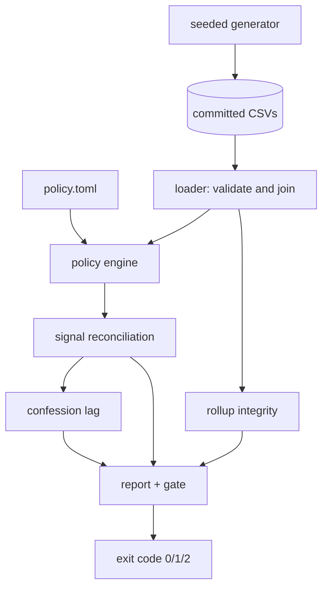
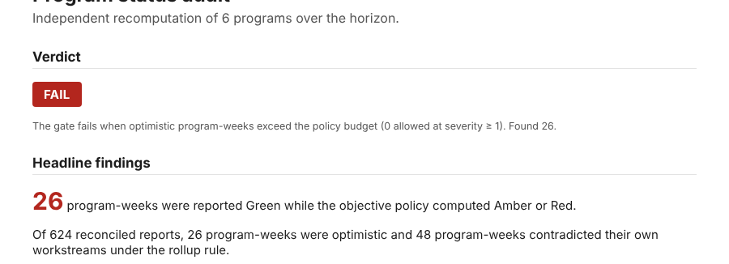

# status-audit

**Recomputes a program's RAG status from objective signals and reconciles it against the
self-reported colour, so a Green report that hides a Red program cannot pass by being read.**

[](https://github.com/Venkata-Pramid-Reddy-Mitta/status-audit/actions/workflows/ci.yml)


A weekly status report hands you a colour: Red, Amber or Green. Reading it tells you nothing
about whether it is honest, because a summary cannot audit itself. The only way to know is to
recompute the colour independently from the objective signals (schedule, cost, open criticals,
overdue milestones) and compare. This tool does that, over a whole portfolio, and reports where
the report was greener than the signals justify.

## Four questions this answers that a status report cannot

1. How many program-weeks were reported Green while the signals already said Amber or Red (the
   watermelon: green outside, red underneath).
2. Once the signals turned, how many weeks did a program stay green on paper before the report
   caught up (the confession lag), and which programs never confessed at all.
3. Does a program's reported colour even follow from its own workstreams' reported colours, or
   does it contradict them on the same page.
4. How much of the finding is the program and how much is where the amber line was drawn.

## The uncomfortable numbers

Across a seeded portfolio of 6 programs over a 26-week horizon, **26 program-weeks were reported Green**
while the recomputed colour was Amber or Red, **16 of them Green over Red**. The longest
single stretch was a **4-week confession lag**, and **1 program never confessed** within the
horizon.

And the number that prices the method itself: that headline of 26 has a **robust floor of 26**
when the amber SPI line is loosened (those weeks are driven by open criticals, overdue
milestones and red-level SPI, not by a marginal amber call), but it **inflates to 63** if the
amber line is tightened to on-plan. This tool detects *disagreement with a policy*, not ground
truth, and it publishes the floor rather than the flattering figure.

Every figure above and below is re-measured by `make verify`: **132 tests**, 100% line and
branch coverage, and a number checker that fails the build if any figure here drifts from the
code. There are **624 reconciled reports** in total.
Counting 468 at the workstream level and 156 at the program level, **0 workstream-weeks were optimistic**:
every gram of optimism in this portfolio was added at the program rollup, not by the workstream
leads. That is the finding, stated as a number.

## Quickstart

Prerequisites: Python 3.11 or newer. No network, no API key, no database.

```bash
pip install -e ".[dev]"

# the one command that produces the headline
python -m status_audit.cli audit

# everything the README promises, offline, from a fresh clone
make verify
```

`audit` exits `0` when the reporting is within the policy's optimism budget, `1` when it finds
optimistic misreporting over budget (the committed data exits `1`), and `2` when it cannot run.

## The headline: green reports over red signals

The audit reconciles every reported cell against a colour recomputed from that cell's signals.

| measure | value |
|---|---|
| reports reconciled | 624 |
| program-weeks reported Green over Amber/Red signals | 26 |
| of those, Green over Red | 16 |
| optimistic workstream-weeks | 0 |
| pessimistic program-weeks (conservative, never blocked) | 25 |

The last two rows are the shape of the problem. The workstream leads reported straight; a
sandbagging program (PRG-DELTA) was conservative.
Across the portfolio there are **25 pessimistic program-weeks** that the gate deliberately
ignored. Only optimism is a delivery risk, so only optimism counts against the gate. See
`experiments/exp_direction_split.py`.

## Confession lag: how long green outlived the truth

A single week's colour cannot tell you how long a program stayed optimistic. That needs the time
series. Confession lag is the gap from the first objectively non-green week to the first reported
non-green week.

| program | signals turned | report turned | verdict |
|---|---|---|---|
| PRG-BEACON | week 10 | week 14 | 4 weeks late |
| PRG-ECHO | week 12 | week 14 | 2 weeks late |
| PRG-CEDAR | week 7 | never | never confessed |
| PRG-DELTA | week 19 | week 1 | conservative (lag 0) |

The lag is **signed**: a report that turns before its signals (DELTA) has a lag of zero, not a
large positive one. That sign was once a bug, and it inverted the entire finding (see below).
Source: `experiments/exp_confession_lag.py`.

## Rollup integrity: a program that contradicts its own workstreams

This check needs no signals. It asks whether a program's reported colour even follows from its
workstreams' reported colours under a stated rule. There are **48 rollup integrity violations**
under the strict worst-of rule. The honest robustness question is how many survive the lenient
rule a reporter would prefer: **17 still contradict** the report even under majority rollup.

| rollup rule | violations |
|---|---|
| worst_of (strict, the default) | 48 |
| majority (lenient) | 17 |

Publishing the second row pre-empts the "you only found those because your rule is strict"
objection. Source: `experiments/exp_rollup_rule.py`, ADR-004.

## What it costs against what it buys

| the strict posture | what it costs | what it buys |
|---|---|---|
| worst-wins band combination | a single healthy dimension cannot soften the colour | a real emergency is never averaged away (ADR-001) |
| optimism-only gate | a sandbagger is recorded but never blocks the build | the gate never fires on conservatism, so it is not deleted (ADR-003) |
| offline seeded data | the demo is not a live feed | every number reproduces with one command (ADR-005) |

## The bug the measurement found

The first confession-lag implementation computed the absolute distance between the two onset
weeks. On the seeded portfolio that handed the worst score to the most honest program: PRG-DELTA
reports amber from week one while its signals stay green until late, and the absolute-value
version reported a phantom lag of 18 weeks for it, ranking the single most conservative program
as the worst watermelon. The sign was the whole finding. The fix (a signed lag, zero when the
report leads the signals) is pinned by `test_confession_lag_is_zero_when_the_report_leads_the_signals`
and written up in ADR-003.

## Architecture





## Evidence



The screenshot above is the real HTML report produced by `status-audit audit --html`, captured
by `tools/capture_screenshots.py`, which also reads the verdict badge's computed colour back and
fails if it is invisible.


The demo is a replay of captured stdout, paced by each command's measured wall time, built by
`tools/record_demo.py`. Every line is real output; the manifest in `docs/video/manifest.json`
lists each command with its exit code.

## The corpus

Six programs, three workstreams each, over a 26-week horizon, generated deterministically by
`status_audit.generate`. The awkward cases are deliberate:

- **PRG-DELTA** is a sandbagger: conservative, reported redder than its signals. It is the case
  that breaks a naive confession-lag metric, and it must be classified pessimistic, not flagged.
- **PRG-FORGE** is a rollup liar: its signals stay green and its program report stays green, yet
  one workstream reported red. It is invisible to signal reconciliation and visible only to the
  rollup check, so it proves the two checks are not redundant.
- **PRG-CEDAR** never confesses: the signals go red and stay red while the report stays green for
  the whole horizon.

Regenerate and diff with `make generate`; a test asserts the committed CSVs are exactly what the
generator writes, so the fixture cannot be hand-edited after the fact.

## What this cannot measure

- **Whether a flagged program was actually in trouble.** A flag means the report disagrees with
  the policy, and the policy thresholds are a choice (ADR-002, ADR-005). The sensitivity sweep is
  the honest accounting: a robust floor of 26 that survives loosening the amber line, and an
  inflated 63 if it is tightened to on-plan.
- **Recurring deterioration.** Confession lag scores the first episode only. A program that
  recovers and relapses has a second episode this version does not score. That is the Pivot.
- **Transient blips.** A one-week objective dip counts as an onset. A sustained-run onset is
  future work, stated here rather than hidden.
- **Anything a real tracker would add.** The data is synthetic by design. A live Jira or Azure
  DevOps feed would change realism, not the method, and would cost reproducibility (ADR-005).

## Layout and exit codes

```
src/status_audit/   engine, reconciliation, rollup, confession, report, generator, cli
policy.toml         every threshold, commented, read with stdlib tomllib
data/               the three committed CSV fixtures
experiments/        five experiments, each answering one README question
tools/              collect_metrics.py, check_numbers.py, and the evidence scripts
docs/adr/           five architecture decision records
```

| exit code | meaning |
|---|---|
| 0 | the audit ran and reporting was within the policy's optimism budget |
| 1 | the audit ran and found optimistic misreporting over budget |
| 2 | the audit could not run (bad data, bad policy, missing file) |

`make verify` runs lint, the suite with coverage, re-measures every figure with
`tools/collect_metrics.py`, and runs `tools/check_numbers.py`, which matches anchor phrases
(a number plus two or three words) rather than bare digits, so a stale sentence fails the build
while a correct one that wraps across a line still passes.

## Tech stack

| technology | role here | why this one |
|---|---|---|
| Python + pandas | load, validate and join the status CSVs | pandas is the natural step up from the Excel and Power BI models this audit replaces, and the join is where a silent row-drop would corrupt the count |
| stdlib `tomllib` | read the commented policy | the policy is the tool's argument, so it must be legible to a non-programmer; TOML keeps comments and adds no dependency (ADR-002) |
| pytest + coverage | 132 tests, 100% line and branch coverage | the headline is only believable if it is pinned; the fixture numbers are locked by tests that fail before the README can go stale |
| Playwright + ffmpeg | screenshots and a replay demo from the real report | evidence a reviewer can regenerate, not a hand-drawn mock (kept out of the default install) |

## Architecture decision records

- [ADR-001](docs/adr/ADR-001-worst-wins-band-combination.md): combine signal bands by worst-wins, not a weighted average.
- [ADR-002](docs/adr/ADR-002-policy-as-config.md): policy thresholds live in a commented TOML file, not in code.
- [ADR-003](docs/adr/ADR-003-confession-lag-is-signed.md): confession lag is signed and first-episode (the war story).
- [ADR-004](docs/adr/ADR-004-rollup-rule-configurable.md): objective rollup is always worst-of; the integrity rule is configurable.
- [ADR-005](docs/adr/ADR-005-synthetic-data-and-the-boundary.md): seeded data, and the boundary between disagreement and truth.

## The Pivot and future work

Out of scope on purpose: **multi-episode confession tracking**. The trigger to add it is the
first dataset where a program recovers and relapses within the horizon, because first-episode
scoring would then undercount. A v2 would also need a sustained-run onset (to drop transient
blips), a per-stakeholder view (the same program reads Green to finance and Amber to engineering),
and a calibration step that fits the policy thresholds to an organisation's own history instead
of asserting them. The first metric to watch after any of these is the robust floor from the
sensitivity sweep, because that is the number that says how much of a finding is real.
